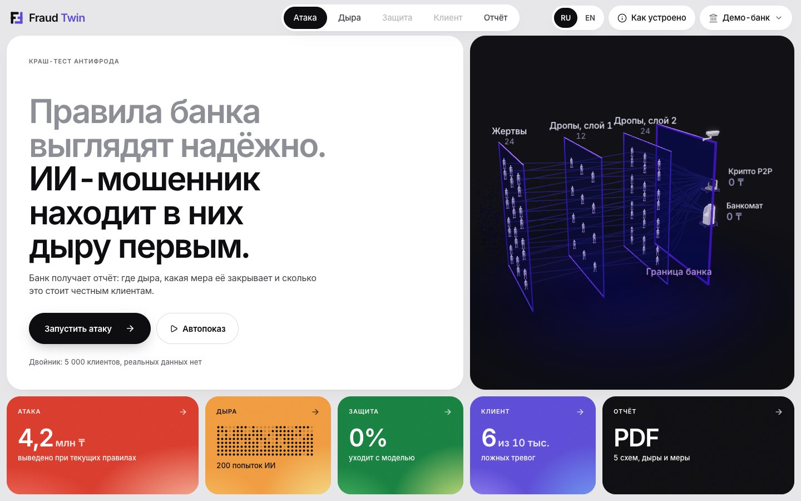
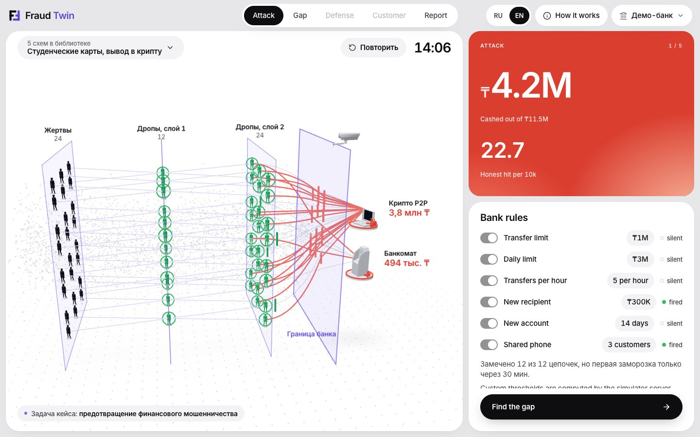
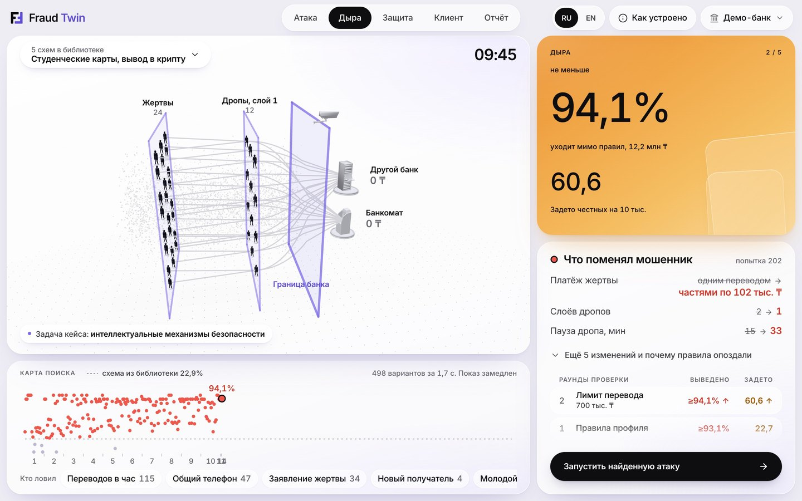
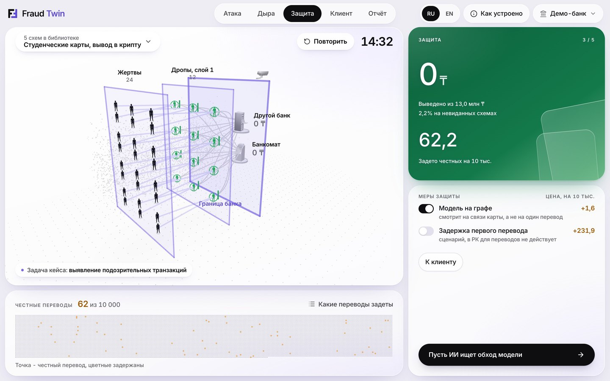
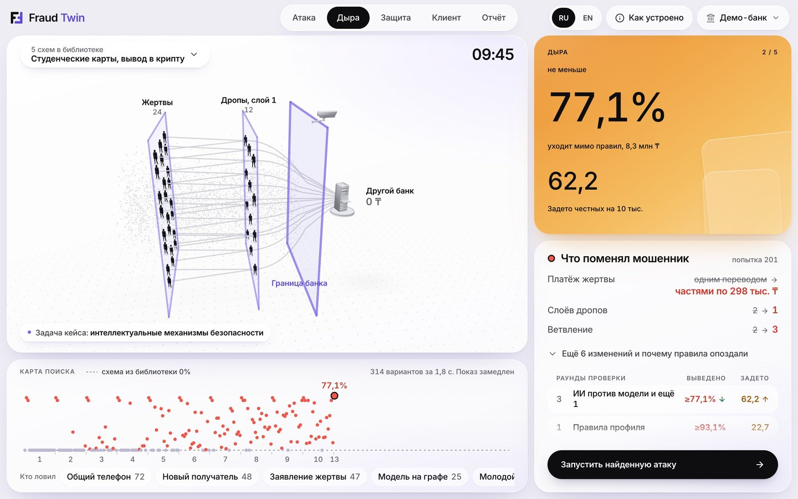

# Fraud Twin: краш-тест антифрода банка

ITU HACKATHON-2026, FINTECH CASE Банка ЦентрКредит. Команда: Shadil Nurmukhammed, Amangeldiev Kaisar, Ordalin Nurassyl, Ratlyauly Islam.

MVP: https://fraud-twin.vercel.app (открывается в браузере, установка не нужна). Демо-видео прилагается к заявке файлом `Fraud-Twin-demo.mp4`. Промо 30 секунд: https://youtu.be/tWMc5O5AH8Q Код: https://github.com/shadix23/fraud-twin. Презентация: https://shadix23.github.io/fraud-twin/pitch/

Fraud Twin строит цифрового двойника банка из агрегатов, без данных клиентов. ИИ-мошенник перебирает схемы дропперов и ищет обход правил этого банка. Банк может вписать свои пороги правил прямо на сайте и через несколько секунд увидеть, как ИИ их обходит. Банк включает меру защиты и видит два числа: сколько денег она сохранит и сколько честных переводов заденет. Клиент в момент перевода видит причину риска словами и может сам отменить перевод.

Все цифры в интерфейсе и в этом файле получены на цифровом двойнике банка. Это не статистика реальных банков. Поиск обхода даёт нижнюю оценку: если ИИ нашёл обход на X%, настоящий обход не меньше X%, поэтому результаты поиска мы пишем со словами «не меньше».

## Задачи кейса и где их смотреть
| Задача кейса BCC | Шаг в продукте | Код |
|---|---|---|
| Предотвращение финансового мошенничества | «Атака»: схема из библиотеки против 6 правил банка, пороги можно поменять. «Дыра»: ИИ-мошенник находит обход этих правил, на карте поиска видна каждая попытка. «Отчёт»: дыры по всем схемам и меры | `sim/fraudtwin/engine.py`, `redteam.py`, `report.py` |
| Защита клиентов при денежных переводах | «Клиент»: макет экрана мобильного банка, перевод на новую карту, три причины словами, кнопка «Отменить перевод». QR-код открывает этот экран на телефоне (адрес `#client`, без 3D) | `sim/fraudtwin/client_check.py`, `app/src/ClientCard.tsx` |
| Выявление подозрительных транзакций | «Защита»: лента переводов, у каждого время, сумма, стороны, риск модели, причина словами и статус. Честные переводы, которые задела мера, идут отдельным списком. Модель включается клавишей 1, атака перезапускается | `sim/fraudtwin/feed.py`, `model.py`, `app/src/Feed.tsx` |
| Интеллектуальные механизмы безопасности | «Защита» -> «Пусть ИИ ищет обход модели» и «Отчёт»: ИИ-мошенник ищет заново против любой новой меры, включая нашу модель, краш-тест повторяется после каждой правки правил | `sim/fraudtwin/redteam.py`, `app/src/Report.tsx` |

Те же четыре задачи со ссылками на шаги есть в самом продукте: кнопка «Как устроено» в шапке (или адрес `#how`). Там же цепочка от симулятора до отчёта, проверка на невиданных схемах и ограничения.

## Скриншоты
Светлый интерфейс v20, цифры v21 (25.11.2026). Есть русский и английский интерфейс (переключатель RU/EN в шапке, `?lang=en`).

| Вход | Атака: правила банка с порогами |
|---|---|
|  |  |
| Дыра: лимит 700 тыс. ₸, ИИ выводит не меньше 94,1%, карта поиска | Защита: модель на графе, 0 ₸ через ту же дыру |
|  |  |
| ИИ против модели: новый поиск, не меньше 77,1% | |
|  | |

## Запуск за 2 минуты
Нужен Node.js 20.19+ (проверено на 24). Интерфейс работает без сервера на готовых прогонах из `app/public/scenarios`.

```bash
cd app
npm install
npm run dev            # http://localhost:4410
```

Адреса: `#twin` открывает двойник сразу, без входа; `#client` открывает экран клиента на весь телефон (без 3D, его же открывает QR-код на шаге «Клиент»); `?lang=en` включает английский; `#report` открывает отчёт; `#calib` открывает калибровку под банк; `#how` открывает «Как устроено». Знак в шапке возвращает на вход без перезагрузки. Профиль банка (Демо, Цифровой, Региональный) выбирается в шапке.

Статическая сборка без сервера (её можно выложить на любой хостинг): `cd app && npm run build:static`, файлы в `app/dist-static`.

Клавиши демо: стрелка вправо запускает главное действие шага, пробел ставит паузу, End проматывает в конец, на шаге «Защита» 1 включает модель, 2 включает задержку первого перевода (сценарий), K открывает шаг «Клиент», Enter там отменяет перевод, Esc возвращает назад. Мышь в сцене: перетаскивание поворачивает, колесо приближает, клик по цепочке показывает её суммы.

### С сервером (свои значения калибровки и живой пересчёт)
```bash
cd sim
python3 -m venv .venv
.venv/bin/pip install fastapi "uvicorn[standard]" numpy scikit-learn
cd ../app && npm install && VITE_API_URL=http://localhost:8410 npm run build && cd ../sim
.venv/bin/uvicorn fraudtwin.api:app --port 8410        # http://localhost:8410, API и интерфейс
```

API: `GET|POST /world`, `GET /attack/{key}`, `POST /attack`, `POST /redteam` (поиск обхода против присланных порогов правил), `GET|POST /report`, `POST /whatif`, `GET|POST /client-check`, `GET /model`, `GET /health`. Ответы в том же формате, что JSON в `app/public/scenarios`. Если API не отвечает, интерфейс молча переходит на готовые прогоны.

### Тесты и пересборка данных
```bash
cd sim
python3 -m unittest discover -s tests       # 67 тестов; без numpy и scikit-learn часть пропускается
.venv/bin/python -m fraudtwin.export        # пересобрать готовые прогоны (устойчивый поиск: 8-12 рестартов на схему, несколько минут)
.venv/bin/python ../model/train.py --worlds 80   # переобучить модель, около 1,5 мин на CPU
```

## Архитектура
```
агрегаты банка ──> world.py ──> двойник: 5 000 клиентов, ~15,5 тыс. переводов за сутки
                                   │
схемы дропперов ──> schemes.py ────┤
правила банка ───> rules.py ───────┤
                                   v
                    engine.py: событийная симуляция атаки, 2-6 мс на прогон
                      │                    │                       │
           redteam.py: ИИ-мошенник   model.py: риск по графу   client_check.py: экран клиента
           (эволюционный поиск,      (бустинг, инференс         (риск получателя до перевода,
            живой ~1,5-2 с)           на чистом Python)          причины словами)
                      │                    │                       │
                      └──────> report.py: отчёт краш-теста, калибровка, 3 профиля
                                           │
                       export.py -> app/public/scenarios/*.json      api.py (FastAPI)
                                           │                            │
                                           └──> app/ (React, TypeScript, Vite, three.js)
```

| Папка | Что внутри |
|---|---|
| `sim/fraudtwin/` | Симулятор на стандартной библиотеке Python 3.10+: мир, схемы, правила, движок, ИИ-мошенник, модель, отчёт, экспорт, API |
| `sim/tests/` | 67 автотестов: симуляция, отчёт, экран клиента, лента переводов, API поиска, детерминизм поиска, переводы RU/EN |
| `model/` | Обучение модели (`train.py`) и результат проверки (`benchmark.json`). Веса лежат в `sim/fraudtwin/model_gbdt.json` |
| `app/` | Интерфейс: `App.tsx` (шаги), `Scene3D.tsx` (сцена атаки), `Panel.tsx` (правила и числа), `Feed.tsx` (лента переводов), `ClientCard.tsx`, `Report.tsx`, `How.tsx` (как устроено и карта задач кейса), `Calibration.tsx`, `Intro.tsx`, `data.ts` (API с откатом на JSON) |

## Как устроен двойник
- Честный банк: сегменты клиентов, круг общения, общие телефоны в семьях. Есть честные сценарии, похожие на транзит денег: сбор на подарок, передача по семье, аренда после зарплаты. Они нужны, чтобы модель не принимала обычную жизнь за дропов.
- Пять схем дропперов из публичных кейсов РК (у каждой поле `source`): студенческие карты с выводом в крипту, звонок «службы безопасности» с веером дропов, дробление под лимит, фейковый продавец с множеством мелких жертв, карусель через сеть онлайн-казино. У дроп-карт есть маскировочная обычная жизнь.
- Шесть правил банка: лимит перевода, суточный лимит, частота переводов, новый получатель и крупная сумма, молодой счёт с крупным входящим, один телефон у нескольких клиентов.
- ИИ-мошенник меняет девять параметров схемы: размер частей платежа жертвы и дропа, число слоёв и ветвление, паузы, возраст дроп-карт, число карт на один телефон, способ вывода. Поиск эволюционный: отбор по выведенной сумме за вычетом цены схемы, скрещивание и мутации, затем доводка мелкими шагами вокруг лучшего варианта. Стартовая популяция засевается лучшими атаками, найденными раньше (`sim/fraudtwin/attack_seeds.json`), они перепроверяются на текущих правилах.
- Готовые прогоны: 8 независимых запусков на схему (популяция 30, 25 поколений, 900 шагов доводки), против модели 12 запусков; побеждает лучший по деньгам. Живой поиск на сайте: 2 запуска (с моделью 1), до 12 поколений, 150 шагов доводки, на Mac 1,5-2 с, на публичной ссылке около 4 с. Зёрна фиксированы: один и тот же запрос даёт один и тот же ответ.
- Любой результат поиска - нижняя оценка. Против правил поиск сходится (8 запусков расходятся не больше чем на 1 п. п.). Против модели не сходится: по 10 независимым запускам разброс от 0 до 98% на одной схеме. Поэтому короткий поиск против модели может показать 0, и это недобор, а не непробиваемость.

## Метод проверки
- Leave-one-scheme-out: модель учится на четырёх схемах и проверяется на пятой, которой не видела. Так по очереди для каждой из пяти схем. Датасет: 400 смоделированных миров со случайными параметрами банка, правил и схем, около 1 млн переводов.
- Главная метрика - деньги: какая доля попытки вывода уходит из банка при правилах и при модели. Рядом всегда цена: сколько честных переводов на 10 тыс. задержано или получили предупреждение.
- Против готовой защиты ИИ-мошенник ищет заново. Мера считается рабочей, если новый поиск тоже не находит крупной дыры. Нашу модель этот тест не проходит (ниже), и мы показываем это в продукте.
- Доля «уходит X из Y» считается к попыткам по найденным схемам: у найденной схемы свой объём попыток, дробление меняет число переводов.
- Экран клиента проверен отдельно: 6 смоделированных миров, 33 611 честных P2P-переводов, 8 атак устойчивого поиска и 96 первых жертв на свежих картах.

## Результаты (Демо-банк, цифровой двойник, 5 000 клиентов)
- Схема из библиотеки (студенческие карты, вывод в крипту): правила замечают 12 из 12 цепочек, но первая заморозка приходит через 30 минут, и 4,2 из 11,5 млн ₸ уходит (37,1%). ИИ-мошенник находит вариант, в котором уходит не меньше 94,1% (12,2 из 13,0 млн ₸): платёж жертвы частями по 102 тыс. ₸, один слой дропов. С моделью на графе переводов эта атака выводит 0 ₸, задержек у честных 24,3 на 10 тыс. вместо 22,7.
- Дыра нашлась в 5 из 5 схем. Через дыры, найденные ИИ, уходит не меньше 51,8 из 54,3 млн ₸ (95,4%), которые мошенники пытались вывести за сутки. По схемам: 94,1 / 96,6 / 100 / 95,2 / 87,5%.
- Свой лимит не спасает: при лимите перевода 300 тыс. ₸ уходит не меньше 93,1%, при 700 тыс. не меньше 94,1%. Цель поиска - деньги, поэтому при любом лимите ИИ подстраивает размер частей.
- Модель на графе переводов против заранее найденных дыр: 0 ₸. Но новый поиск против модели выводит не меньше 33,7 из 44,1 млн ₸ (76,4%), обход нашёлся в 5 из 5 схем (80,4 / 98,2 / 66,6 / 86,3 / 50,0%). Вывод: любую меру, включая нашу модель, нужно проверять заново, банку нужен постоянный краш-тест.
- На невиданных схемах (учим на четырёх, проверяем на пятой) правила банка в среднем пропускают 44,5% денег, модель 2,2%.
- Ложное предупреждение клиенту получают около 6 честных переводов из 10 тыс. (5,7).
- Первая жертва на свежую карту проходит без предупреждения в 80,2% случаев (77 из 96). Следующие жертвы на той же карте прикрыты в 100% случаев (96 из 96): предупреждение или карта уже заморожена.

| Профиль | Через дыры, не меньше | ИИ против модели, не меньше | Обход модели |
|---|---|---|---|
| Демо-банк | 51,8 из 54,3 млн ₸ (95,4%) | 33,7 из 44,1 млн ₸ (76,4%) | 5 из 5 схем |
| Цифровой банк | 48,8 из 52,6 млн ₸ (92,8%) | 38,7 из 48,3 млн ₸ (80,2%) | 5 из 5 схем |
| Региональный банк | 51,3 из 51,7 млн ₸ (99,1%) | 39,5 из 48,9 млн ₸ (80,8%) | 5 из 5 схем |

## Как банк проверит это на своих данных
1. Свои правила уже сейчас: на шаге «Атака» банк вписывает свои пороги (лимит перевода, суточный лимит, частота, новый получатель, молодой счёт, общий телефон), можно загрузить их файлом JSON. Поиск обхода считается на сервере против этих порогов, на публичной ссылке около 4 с.
2. Калибровка по агрегатам: размер базы, сегменты, средние переводы, скорость реакции антифрода. Данные клиентов не нужны. В MVP это три готовых профиля и свой профиль через API (`#calib`).
3. Запуск в контуре банка на его истории (план пилота, в MVP нет): Fraud Twin ставится внутри периметра банка, двойник настраивается по истории переводов банка, краш-тест идёт против действующих правил. Банк сверяет найденные дыры со случаями, которые уже знает, и решает, верить ли отчёту. Наружу данные не уходят.
4. Через две недели отчёт: какие дыры есть, сколько через них уходит, какие меры их закрывают и сколько честных клиентов заденут.

## Экономика для банка
Подробно: `hackathon/economics.md`. Калькулятор на сайте: шаг «Отчёт», плита «Экономика для банка» под листом отчёта (в PDF печатается строкой).

- **Что это для банка.** Не замена антифроду, а краш-тест для него: как пентест для ИБ. Правила, сессионный антифрод и модель скоринга остаются, мы проверяем, где их можно обойти, и какой ценой для честных клиентов закрыть дыру.
- **Цена (предложение команды, допущение).** Пилот 2 недели: для BCC 0 ₸, другим банкам 3 млн ₸ с зачётом в подписку. Подписка 24 млн ₸ в год (МФО и платёжные организации 6 млн ₸). Публичных цен на антифрод у вендоров нет; единственный ориентир, Feedzai на AWS Marketplace, около 349 тыс. USD за 3 года для малой конфигурации (только выдача поисковика).
- **Внедрение со стороны банка.** 6-8 человеко-дней: две встречи с антифродом, агрегаты вместо данных клиентов, один контейнер в контуре, без интеграции в процессинг.
- **Формула.** Экономия в год = потери x доля через найденные дыры x доля, которую закрывает мера + расходы на ручные проверки x снижение. Окупаемость = (подписка + внедрение) / (экономия / 12).
- **Пример на допущениях (данных BCC у нас нет).** Базовый сценарий: потери банка 1,2 млрд ₸ в год (10% от 12,2 млрд ₸ ущерба от интернет-мошенничества по РК за 2025, Генпрокуратура), 30% через дыры, мера закрывает 40%, ручные проверки 120 млн ₸ минус 10%. Экономия 156 млн ₸ в год, окупаемость около 2 месяцев. Осторожный: 27 млн ₸, около 11 месяцев. Подписка окупается, если краш-тест помогает убрать около 2% годовых потерь.
- **Откуда доля «мера закрывает».** В двойнике мера на найденных дырах даёт 0 ₸ (100%), но против нового поиска ИИ уходит 76,4% вместо 95,4%, это около 20%. Осторожный сценарий берёт именно 20%. Деньги двойника на масштаб банка не умножаем.
- **Почему выгодно.** АРРФР (28.07.2026): обязательные антифрод-подразделения, задержка подозрительного перевода до 5 рабочих дней, сессионный антифрод с апреля 2026, обмен рисками P2P. Ст. 25-1 п. 7: перевод получателю из базы Антифрод-центра банк возмещает сам. Вендоры по своим заявлениям проверяют правила на истории (бэктест, shadow mode), а краш-тест ищет обходы, которых в истории ещё нет.

## Ограничения
- Всё посчитано на синтетике. Качество модели на данных банка мы не измеряли.
- Результаты поиска - нижние оценки. Против модели поиск не сходится, настоящий обход, скорее всего, больше показанного. Живой поиск на сайте (2 запуска) может показать чуть меньше готового прогона (студенческие карты, правила профиля: 93,1% против 94,1%).
- Наша модель не защищает от нового поиска: обход в 5 из 5 схем. Мы продаём проверку, модель - одна из мер, которые эта проверка оценивает.
- Параметры двойника - гипотезы до разговоров с антифрод-специалистами банков.
- Слабое место модели - дробление платежа под лимит. Первая жертва на новую карту чаще проходит без предупреждения.
- Модель - градиентный бустинг на признаках графа (scikit-learn), нейросеть на графах не делали. LightGBM не использовали, на Mac он требует системную libomp.
- Задержка первого перевода в двойнике - сценарий моделирования. В РК для переводов физлиц такой нормы нет.
- Без сервера доступны три готовых профиля банка, свои значения калибровки и поиск против своих порогов считает API.
- Отчёт посчитан для правил профиля; раунды со своими порогами показаны отдельным блоком «Ход проверки».

## Правовая база
Закон РК «О платежах и платёжных системах» № 11-VI, ст. 25-1 (adilet.zan.kz/rus/docs/Z1600000011, сверено 23.11.2026): п. 3-1 разрешает банку приостановить перевод или заблокировать сумму на срок не более пяти рабочих дней с сообщением клиенту причин и оснований; п. 7 делает банк ответственным перед клиентом, если он перечислил деньги бенефициару из базы антифрод-центра.

## Источники цифр рынка
- Больше 112 млрд ₸ через дропперов: АФМ РК, gov.kz, 11.07.2026.
- 12,2 млрд ₸ ущерба от интернет-мошенничества за 2025 год, возвращено около 5 млрд: Генпрокуратура, bes.media, 08.04.2026.
- 23 банка второго уровня РК: АРРФР, на 01.07.2026.

## Лицензии
Код: MIT, файл `LICENSE`.

3D-модели лежат в `app/public/models/`, подробно в `app/CREDITS.md`:
- CC-BY 3.0, строка авторства обязательна и показана в подвале отчёта: ATM (J-Toastie, poly.pizza), server rack (Jeremy Eyring, poly.pizza). Геометрия сжата, материалы заменены на палитру проекта.
- CC0 1.0: Security Camera 01 (Alexander Otterbeck, риг Yann Kervran, Poly Haven), Classic Laptop (Arrangemonk, Poly Haven), Coin, Coin Piles, Man in Suit (Quaternius, poly.pizza).
- Библиотеки: drei, @react-three/fiber, @react-three/postprocessing, postprocessing (MIT). Шрифт Inter (OFL) через Fontsource, локально. Код под AGPL не использован.
