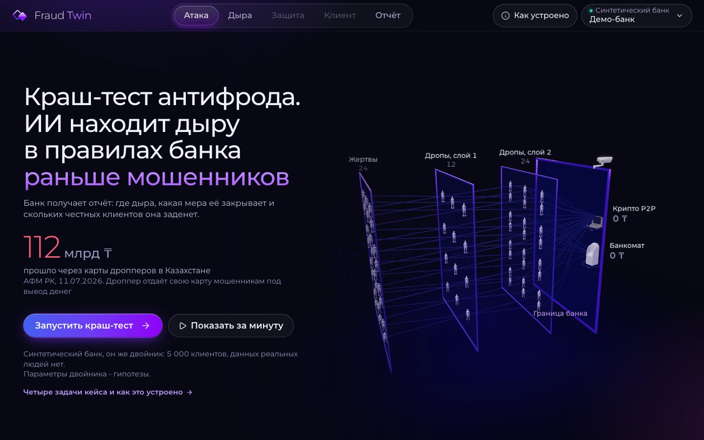
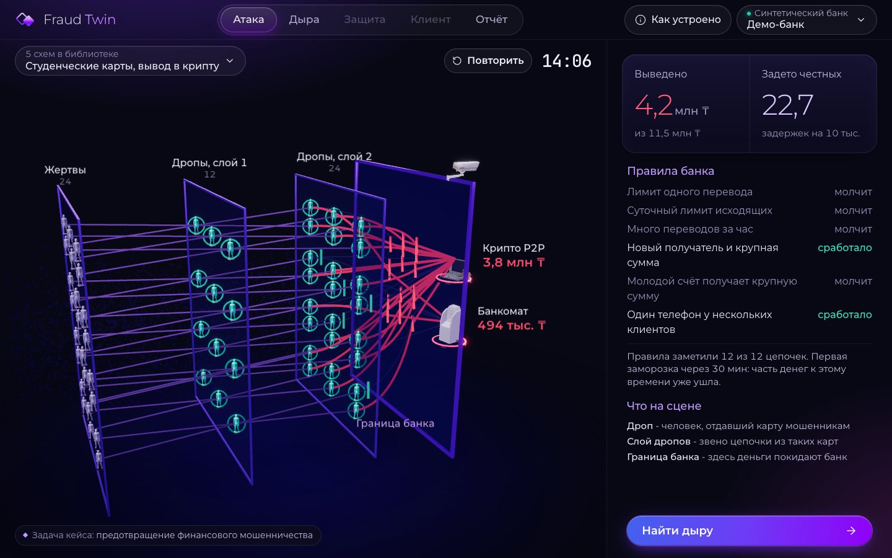
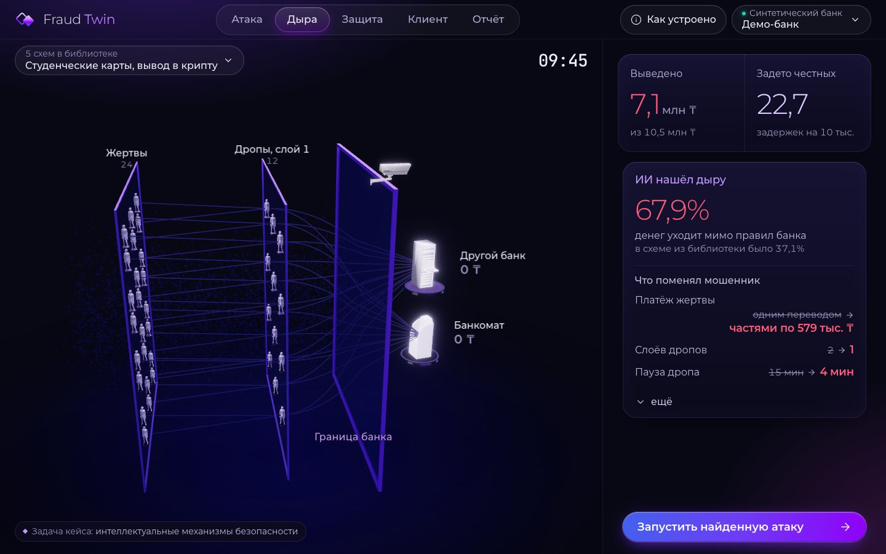
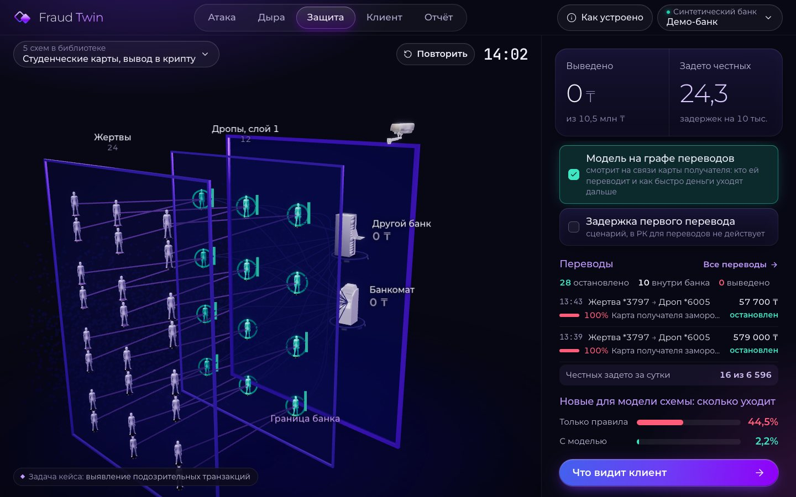
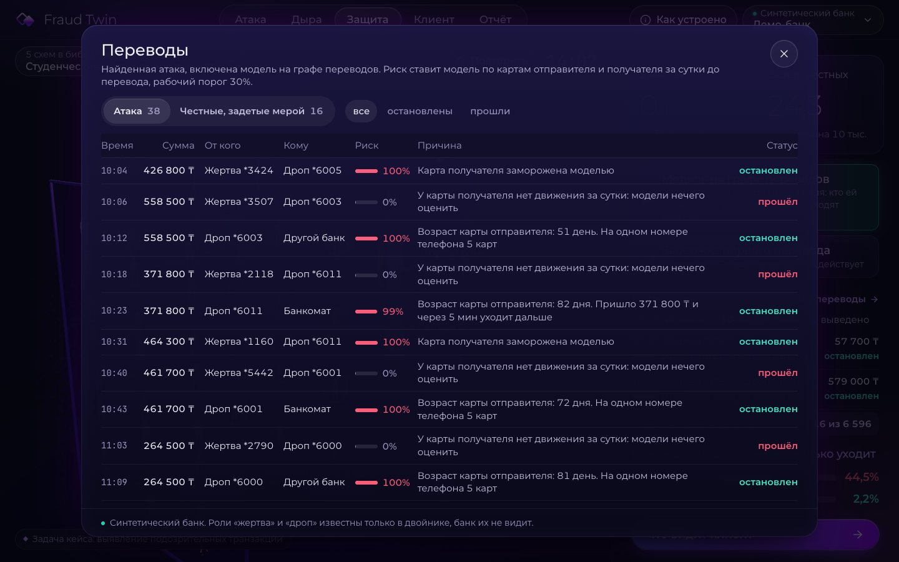
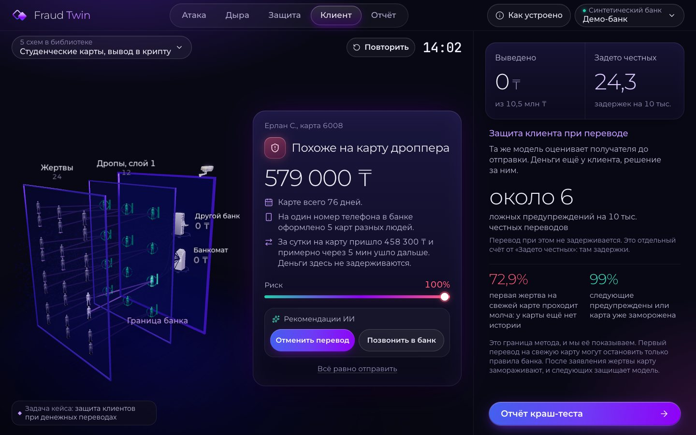
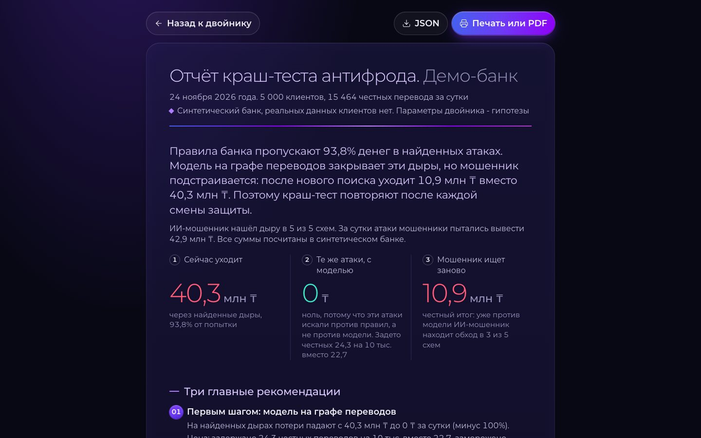
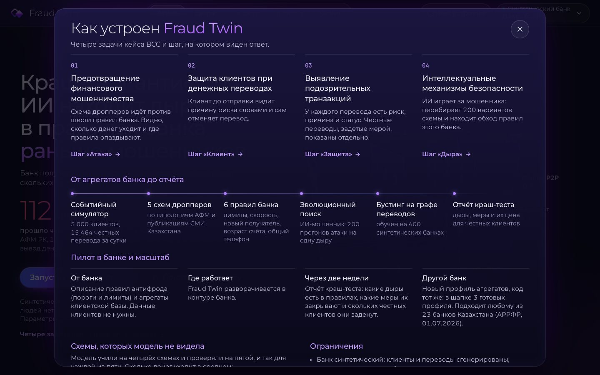
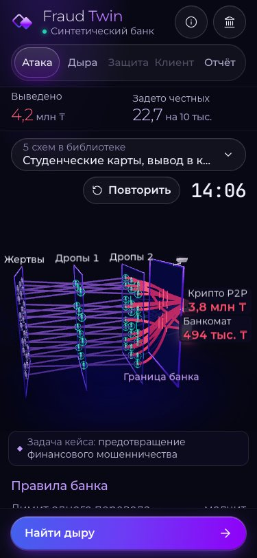

# Fraud Twin: краш-тест антифрода банка

ITU HACKATHON-2026, FINTECH CASE Банка ЦентрКредит. Команда: Shadil Nurmukhammed, Amangeldiev Kaisar, Ordalin Nurassyl.

MVP: https://fraud-twin.vercel.app (открывается в браузере, установка не нужна). Демо-видео прилагается к заявке файлом `Fraud-Twin-demo.mp4`. Код: https://github.com/shadix23/fraud-twin

Fraud Twin строит цифрового двойника банка из агрегатов, без данных клиентов. ИИ-мошенник перебирает схемы дропперов и ищет обход правил этого банка. Банк включает меру защиты и видит два числа: сколько денег она сохранит и сколько честных переводов заденет. Клиент в момент перевода видит причину риска словами и может сам отменить перевод.

Все цифры в интерфейсе и в этом файле получены в синтетическом банке. Это не статистика реальных банков.

## Задачи кейса и где их смотреть
| Задача кейса BCC | Шаг в продукте | Код |
|---|---|---|
| Предотвращение финансового мошенничества | «Атака»: схема из библиотеки против 6 правил банка. «Дыра»: ИИ-мошенник находит обход. «Отчёт»: дыры по всем схемам и меры | `sim/fraudtwin/engine.py`, `redteam.py`, `report.py` |
| Защита клиентов при денежных переводах | «Клиент»: экран мобильного банка, перевод 579 000 ₸ на новую карту, три причины словами, кнопка «Отменить перевод» | `sim/fraudtwin/client_check.py`, `app/src/ClientCard.tsx` |
| Выявление подозрительных транзакций | «Защита»: лента переводов, у каждого время, сумма, стороны, риск модели, причина словами и статус. Честные переводы, которые задела мера, идут отдельным списком. Модель включается клавишей 1, атака перезапускается | `sim/fraudtwin/feed.py`, `model.py`, `app/src/Feed.tsx` |
| Интеллектуальные механизмы безопасности | «Дыра» и «Отчёт»: против модели ИИ-мошенник ищет заново, краш-тест повторяется после каждой правки правил | `sim/fraudtwin/redteam.py`, `app/src/Report.tsx` |

Те же четыре задачи со ссылками на шаги есть в самом продукте: кнопка «Как устроено» в шапке (или адрес `#how`). Там же цепочка от симулятора до отчёта, проверка на невиданных схемах и ограничения.

## Скриншоты
Экраны версии v18 (24.11.2026), статическая сборка без сервера.

| Вход | Атака |
|---|---|
|  |  |
| Дыра: ИИ нашёл обход, 67,9% денег мимо правил | Защита: меры и лента переводов |
|  |  |
| Все переводы | Клиент |
|  |  |
| Отчёт | Как устроено |
|  |  |

Телефон, 375 px, шаг «Атака»: 

## Запуск за 2 минуты
Нужен Node.js 20.19+ (проверено на 24). Интерфейс работает без сервера на готовых прогонах из `app/public/scenarios`.

```bash
cd app
npm install
npm run dev            # http://localhost:4410
```

Адреса: `#twin` открывает двойник сразу, без входа; `#report` открывает отчёт; `#calib` открывает калибровку под банк; `#how` открывает «Как устроено». Знак в шапке возвращает на вход без перезагрузки. Профиль банка (Демо, Цифровой, Региональный) выбирается в шапке.

Статическая сборка без сервера (её можно выложить на любой хостинг): `cd app && npm run build:static`, файлы в `app/dist-static`.

Клавиши демо: стрелка вправо запускает главное действие шага, пробел ставит паузу, End проматывает в конец, на шаге «Защита» 1 включает модель, 2 включает задержку первого перевода (сценарий), K открывает шаг «Клиент», Enter там отменяет перевод, Esc возвращает назад. Мышь в сцене: перетаскивание поворачивает, колесо приближает, клик по цепочке показывает её суммы.

### С сервером (свои значения калибровки и живой пересчёт)
```bash
cd sim
python3 -m venv .venv
.venv/bin/pip install fastapi "uvicorn[standard]" numpy scikit-learn
cd ../app && npm install && VITE_API_URL=http://localhost:8410 npm run build && cd ../sim
.venv/bin/uvicorn fraudtwin.api:app --port 8410        # http://localhost:8410, API и интерфейс
```

API: `GET|POST /world`, `GET /attack/{key}`, `POST /attack`, `POST /redteam`, `GET|POST /report`, `POST /whatif`, `GET /model`. Ответы в том же формате, что JSON в `app/public/scenarios`. Если API не отвечает, интерфейс молча переходит на готовые прогоны.

### Тесты и пересборка данных
```bash
cd sim
python3 -m unittest discover -s tests       # 47 тестов; без numpy и scikit-learn 2 пропускаются
.venv/bin/python -m fraudtwin.export        # пересобрать готовые прогоны, около 20 с
.venv/bin/python ../model/train.py --worlds 80   # переобучить модель, около 1,5 мин на CPU
```

## Архитектура
```
агрегаты банка ──> world.py ──> двойник: 5 000 клиентов, ~15,5 тыс. переводов за сутки
                                   │
схемы дропперов ──> schemes.py ────┤
правила банка ───> rules.py ───────┤
                                   v
                    engine.py: событийная симуляция атаки, 2-6 мс на прогон
                      │                    │                       │
           redteam.py: ИИ-мошенник   model.py: риск по графу   client_check.py: экран клиента
           (эволюционный поиск,      (бустинг, инференс         (риск получателя до перевода,
            200 прогонов ~1 с)        на чистом Python)          причины словами)
                      │                    │                       │
                      └──────> report.py: отчёт краш-теста, калибровка, 3 профиля
                                           │
                       export.py -> app/public/scenarios/*.json      api.py (FastAPI)
                                           │                            │
                                           └──> app/ (React, TypeScript, Vite, three.js)
```

| Папка | Что внутри |
|---|---|
| `sim/fraudtwin/` | Симулятор на стандартной библиотеке Python 3.10+: мир, схемы, правила, движок, ИИ-мошенник, модель, отчёт, экспорт, API |
| `sim/tests/` | 47 автотестов: симуляция, отчёт, экран клиента, лента переводов |
| `model/` | Обучение модели (`train.py`) и результат проверки (`benchmark.json`). Веса лежат в `sim/fraudtwin/model_gbdt.json` |
| `app/` | Интерфейс: `App.tsx` (шаги), `Scene3D.tsx` (сцена атаки), `Panel.tsx` (правила и числа), `Feed.tsx` (лента переводов), `ClientCard.tsx`, `Report.tsx`, `How.tsx` (как устроено и карта задач кейса), `Calibration.tsx`, `Intro.tsx`, `data.ts` (API с откатом на JSON) |

## Как устроен двойник
- Честный банк: сегменты клиентов, круг общения, общие телефоны в семьях. Есть честные сценарии, похожие на транзит денег: сбор на подарок, передача по семье, аренда после зарплаты. Они нужны, чтобы модель не принимала обычную жизнь за дропов.
- Пять схем дропперов из публичных кейсов РК (у каждой поле `source`): студенческие карты с выводом в крипту, звонок «службы безопасности» с веером дропов, дробление под лимит, фейковый продавец с множеством мелких жертв, карусель через сеть онлайн-казино. У дроп-карт есть маскировочная обычная жизнь.
- Шесть правил банка: лимит перевода, суточный лимит, частота переводов, новый получатель и крупная сумма, молодой счёт с крупным входящим, один телефон у нескольких клиентов.
- ИИ-мошенник меняет девять параметров схемы: размер частей платежа жертвы и дропа, число слоёв и ветвление, паузы, возраст дроп-карт, число карт на один телефон, способ вывода. Поиск эволюционный: популяция из 20 вариантов, 10 поколений, отбор по выведенной сумме, скрещивание и мутации, всего около 200 прогонов.

## Метод проверки
- Leave-one-scheme-out: модель учится на четырёх схемах и проверяется на пятой, которой не видела. Так по очереди для каждой из пяти схем. Датасет: 400 синтетических миров со случайными параметрами банка, правил и схем, около 1 млн переводов.
- Главная метрика - деньги: какая доля попытки вывода уходит из банка при правилах и при модели. Рядом всегда цена: сколько честных переводов на 10 тыс. задержано или получили предупреждение.
- Против готовой защиты ИИ-мошенник ищет заново. Мера считается рабочей, если новый поиск тоже не находит крупной дыры.
- Экран клиента проверен отдельно: 6 синтетических миров, 33 611 честных P2P-переводов и 96 первых жертв на свежих картах.

## Результаты (синтетический Демо-банк, 5 000 клиентов)
- Схема из библиотеки (студенческие карты, вывод в крипту): правила замечают 12 из 12 цепочек, но первая заморозка приходит через 30 минут, и 4,2 из 11,5 млн ₸ уходит (37,1%). ИИ-мошенник находит вариант, в котором уходит 7,1 из 10,5 млн ₸ (67,9%). С моделью на графе переводов эта атака выводит 0 ₸, задержек у честных 24,3 на 10 тыс. вместо 22,7.
- Дыра нашлась в 5 из 5 схем. Через дыры, найденные ИИ, уходит 40,3 из 42,9 млн ₸, которые мошенники пытались вывести за сутки.
- С моделью на графе переводов новый поиск находит обход на 10,9 млн ₸.
- На невиданных схемах правила банка в среднем пропускают 44,5% денег, модель 2,2%.
- Ложное предупреждение клиенту получают около 6 честных переводов из 10 тыс. (5,7).
- Первая жертва на свежую карту проходит без предупреждения в 72,9% случаев (70 из 96). Следующие жертвы в 99% случаев (95 из 96) получают предупреждение, или карта уже заморожена.

## Ограничения
- Всё посчитано на синтетике. Качество модели на данных банка мы не измеряли.
- Параметры двойника - гипотезы до разговоров с антифрод-специалистами банков.
- Слабое место модели - дробление платежа под лимит. Первая жертва на новую карту чаще проходит без предупреждения.
- Модель - градиентный бустинг на признаках графа (scikit-learn), нейросеть на графах не делали. LightGBM не использовали, на Mac он требует системную libomp.
- Задержка первого перевода в двойнике - сценарий моделирования. В РК для переводов физлиц такой нормы нет.
- Без сервера доступны три готовых профиля банка, свои значения калибровки считает API.

## Правовая база
Закон РК «О платежах и платёжных системах» № 11-VI, ст. 25-1 (adilet.zan.kz/rus/docs/Z1600000011, сверено 23.11.2026): п. 3-1 разрешает банку приостановить перевод или заблокировать сумму на срок не более пяти рабочих дней с сообщением клиенту причин и оснований; п. 7 делает банк ответственным перед клиентом, если он перечислил деньги бенефициару из базы антифрод-центра.

## Источники цифр рынка
- Больше 112 млрд ₸ через дропперов: АФМ РК, gov.kz, 11.07.2026.
- 12,2 млрд ₸ ущерба от интернет-мошенничества за 2025 год, возвращено около 5 млрд: Генпрокуратура, bes.media, 08.04.2026.
- 23 банка второго уровня РК: АРРФР, на 01.07.2026.

## Лицензии
Код: MIT, файл `LICENSE`.

3D-модели лежат в `app/public/models/`, подробно в `app/CREDITS.md`:
- CC-BY 3.0, строка авторства обязательна и показана в подвале отчёта: ATM (J-Toastie, poly.pizza), server rack (Jeremy Eyring, poly.pizza). Геометрия сжата, материалы заменены на палитру проекта.
- CC0 1.0: Security Camera 01 (Alexander Otterbeck, риг Yann Kervran, Poly Haven), Classic Laptop (Arrangemonk, Poly Haven), Coin, Coin Piles, Man in Suit (Quaternius, poly.pizza).
- Библиотеки: drei, @react-three/fiber, @react-three/postprocessing, postprocessing (MIT). Шрифты Montserrat и JetBrains Mono (OFL) через Fontsource. Код под AGPL не использован.
