<p align="center">
  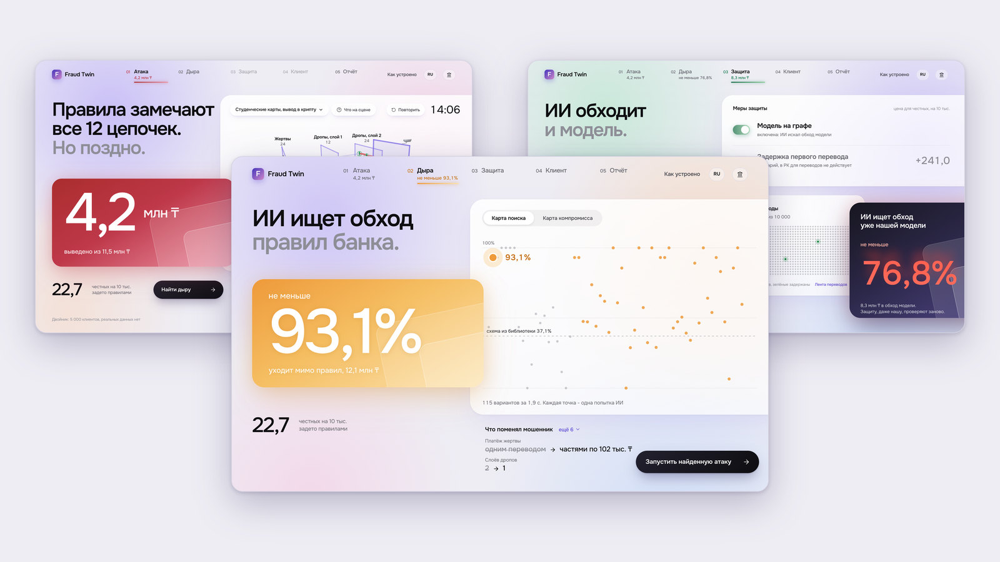
</p>

<h1 align="center">Fraud Twin</h1>

<p align="center"><b>Краш-тест антифрода банка.</b> ИИ-мошенник ищет обход правил банка на его цифровом двойнике, банк видит, сколько денег уходит через дыру и сколько честных клиентов заденет мера, которая её закроет.</p>

<p align="center">
  <a href="https://fraud-twin.vercel.app"></a>
  <a href="https://shadix23.github.io/fraud-twin/pitch/"></a>
  <a href="https://youtu.be/tWMc5O5AH8Q"></a>
  <a href="LICENSE"></a>
</p>

<p align="center">ITU HACKATHON-2026, FINTECH CASE Банка ЦентрКредит. Сайт открывается в браузере, установка не нужна. Демо-видео приложено к заявке файлом <code>Fraud-Twin-demo.mp4</code>.</p>

<table>
  <tr>
    <td align="center" width="33%"><h2>не меньше 95,4%</h2>денег мошенников уходит через дыры, которые ИИ нашёл в правилах банка. Дыра есть в 5 из 5 схем</td>
    <td align="center" width="33%"><h2>0 ₸</h2>проходит через те же дыры, когда включена модель на графе переводов</td>
    <td align="center" width="33%"><h2>не меньше 76,4%</h2>выводит новый поиск ИИ уже против модели. Любую меру надо проверять заново</td>
  </tr>
</table>

Все цифры получены на цифровом двойнике Демо-банка (5 000 клиентов, синтетические данные), это не статистика реальных банков. Поиск обхода даёт нижнюю оценку, поэтому его результаты пишем со словами «не меньше».

## Задачи кейса BCC

| Задача кейса | Где в продукте | Код |
|---|---|---|
| Предотвращение финансового мошенничества | **Атака**: схема из библиотеки против 6 правил банка, пороги можно вписать свои. **Дыра**: ИИ-мошенник ищет обход, каждая попытка видна на карте поиска. **Отчёт**: дыры по всем схемам и меры | `sim/fraudtwin/engine.py`, `redteam.py`, `report.py` |
| Защита клиентов при денежных переводах | **Клиент**: экран мобильного банка, перевод на новую карту, три причины риска словами и кнопка «Отменить перевод». QR-код открывает этот экран на телефоне | `sim/fraudtwin/client_check.py`, `app/src/ClientCard.tsx` |
| Выявление подозрительных транзакций | **Защита**: лента переводов, у каждого риск модели, причина словами и статус. Честные переводы, которые задела мера, идут отдельным списком | `sim/fraudtwin/feed.py`, `model.py`, `app/src/Feed.tsx` |
| Интеллектуальные механизмы безопасности | **Защита** -> «Пусть ИИ ищет обход модели»: ИИ-мошенник ищет заново против любой новой меры, включая нашу модель. Краш-тест повторяется после каждой правки правил | `sim/fraudtwin/redteam.py`, `app/src/Report.tsx` |

Та же карта задач есть в самом продукте: кнопка «Как устроено» в шапке (адрес `#how`).

## Путь демо

<p align="center">
  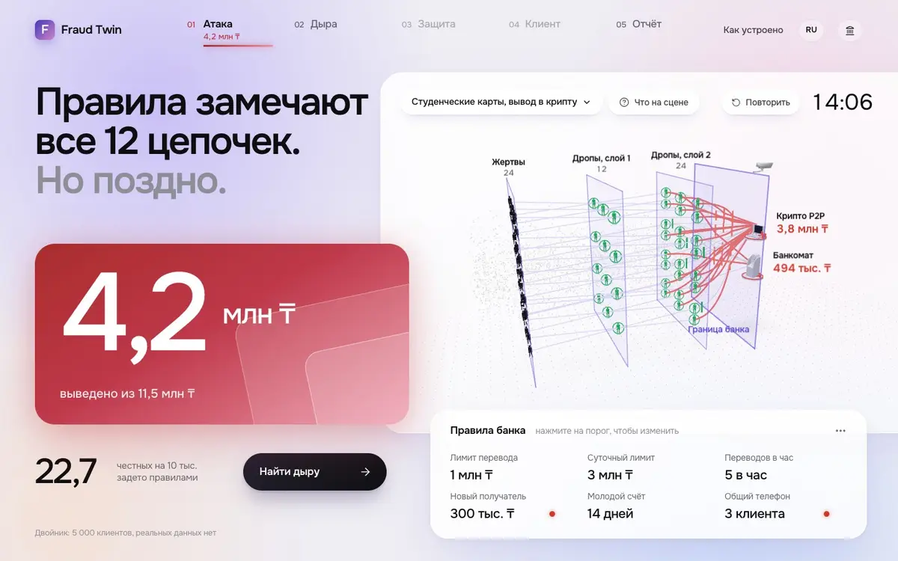<br>
  <sub>Запись с сайта: Атака -> Дыра -> Защита. Поиск ИИ ускорен в 14 раз.</sub>
</p>

<table>
  <tr>
    <td width="50%" valign="top">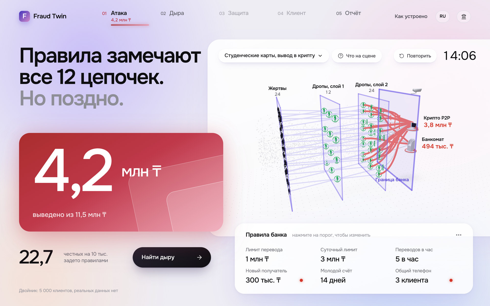<br><b>1. Атака.</b> Правила замечают все 12 цепочек, но первая заморозка приходит через 30 минут: уходит 4,2 из 11,5 млн ₸.</td>
    <td width="50%" valign="top">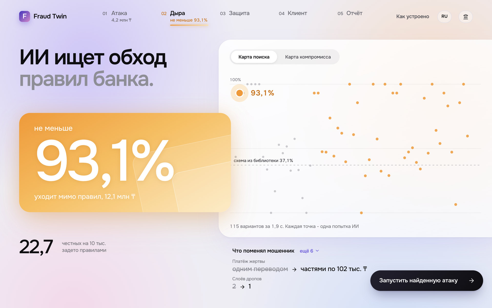<br><b>2. Дыра.</b> ИИ перебирает схемы, каждая точка на карте - одна попытка. Живой поиск на сайте: не меньше 93,1% денег мимо правил.</td>
  </tr>
  <tr>
    <td valign="top">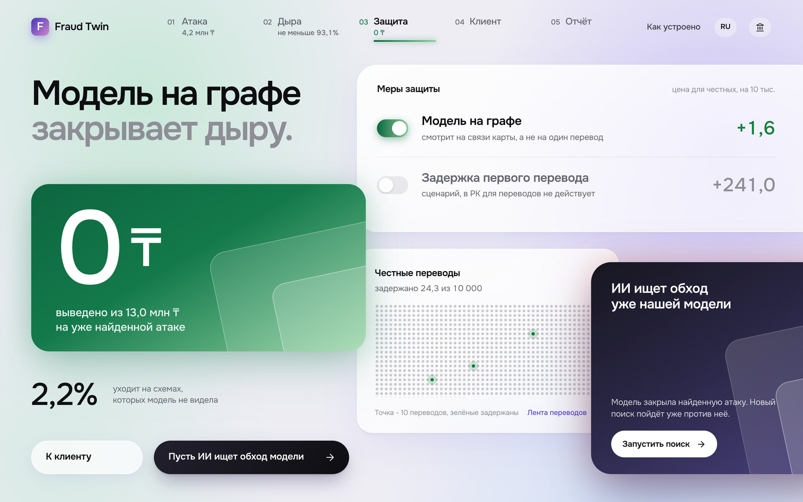<br><b>3. Защита.</b> Модель на графе переводов: через ту же дыру 0 ₸. Цена для честных: +1,6 задержки на 10 тыс. переводов.</td>
    <td valign="top">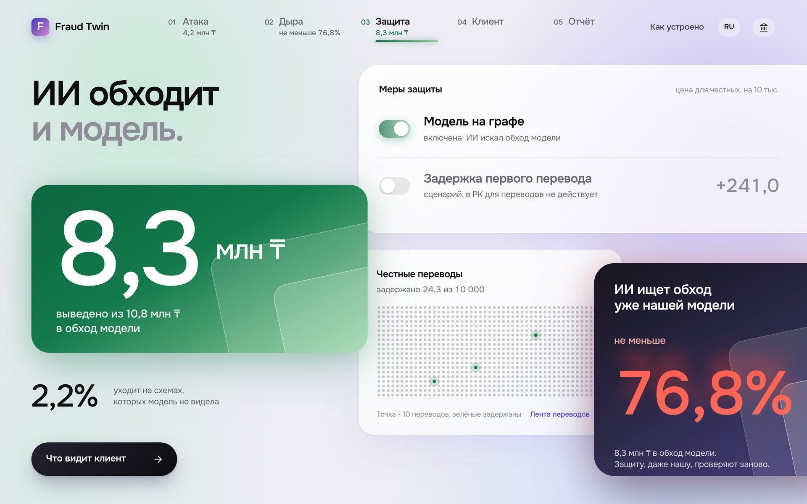<br><b>4. ИИ против модели.</b> Новый поиск обходит и нашу модель: не меньше 76,8% на этой схеме. Мы показываем это в продукте.</td>
  </tr>
  <tr>
    <td valign="top">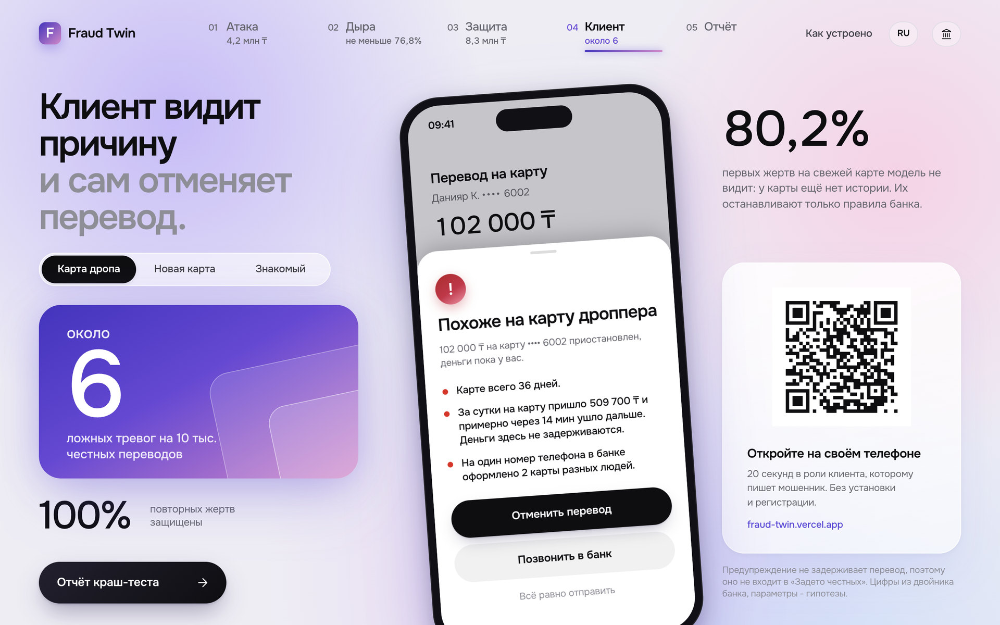<br><b>5. Клиент.</b> Перед переводом на карту дроппера клиент видит три причины словами и сам отменяет перевод.</td>
    <td valign="top">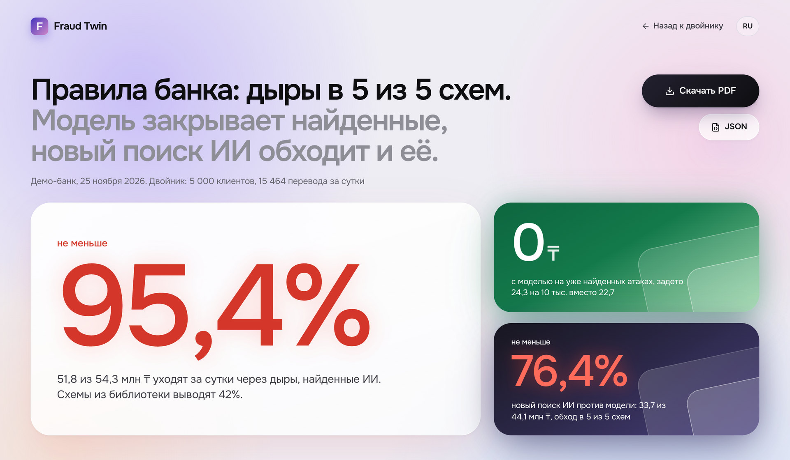<br><b>6. Отчёт.</b> Дыры в 5 из 5 схем, итог по деньгам и мерам. Скачивается в PDF и JSON.</td>
  </tr>
</table>

<table>
  <tr>
    <td align="center" valign="top">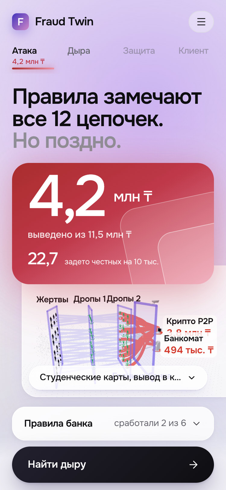</td>
    <td align="center" valign="top">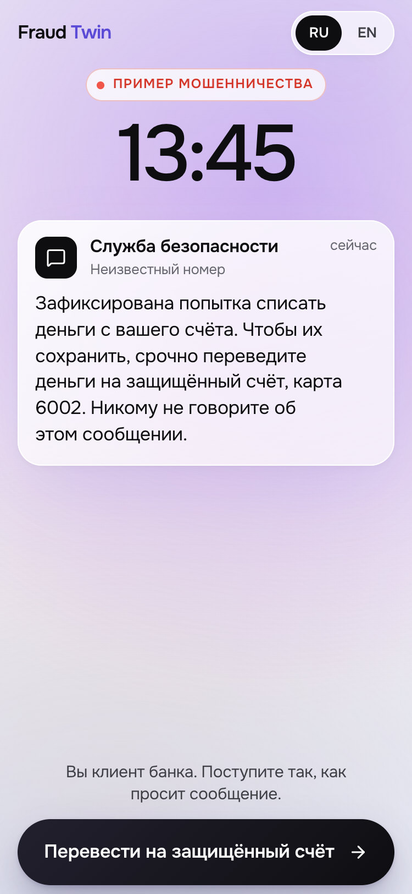</td>
    <td align="center" valign="top">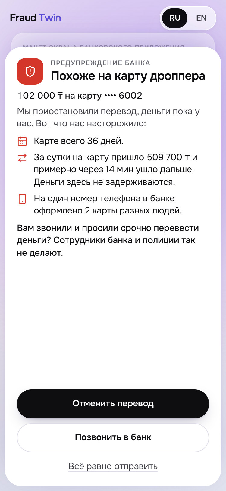</td>
  </tr>
  <tr>
    <td colspan="3" align="center"><sub>Телефон, 375 px: атака, SMS «службы безопасности» и предупреждение перед переводом. Экран клиента открывается по QR-коду (адрес <code>#client</code>).</sub></td>
  </tr>
</table>

Интерфейс на русском и английском: переключатель RU/EN в шапке или `?lang=en`.

## Экономика для банка

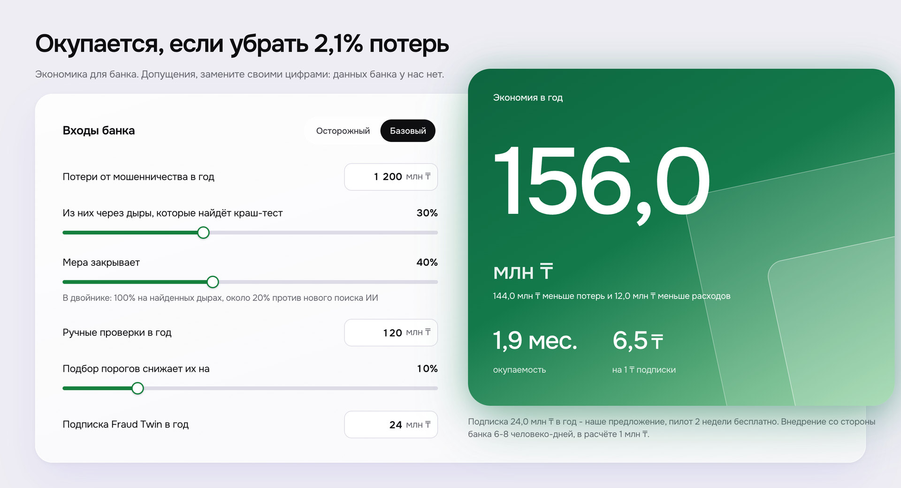

| | |
|---|---|
| Что продаём | Краш-тест антифрода, как пентест для ИБ. Правила, сессионный антифрод и скоринг остаются, мы ищем, где их обходят |
| Цена (предложение команды) | Пилот 2 недели: для BCC 0 ₸, другим банкам 3 млн ₸ с зачётом. Подписка 24 млн ₸ в год, МФО и платёжные организации 6 млн ₸ |
| Внедрение | 6-8 человеко-дней со стороны банка: агрегаты вместо данных клиентов, один контейнер в контуре, без интеграции в процессинг |
| Пример на допущениях | Потери 1,2 млрд ₸ в год, 30% через дыры, мера закрывает 40%: экономия 156 млн ₸ в год, окупаемость около 2 месяцев. Осторожный сценарий (мера закрывает 20%): 27 млн ₸, около 11 месяцев |

Подписка окупается, если краш-тест помогает убрать около 2% годовых потерь. Калькулятор со своими цифрами банка: шаг «Отчёт», блок «Экономика для банка». Данных BCC у нас нет, все входы - допущения.

## Как банк проверит это на своих данных

1. **Свои правила уже сейчас.** На шаге «Атака» банк вписывает свои пороги или загружает их файлом JSON. Поиск обхода считается на сервере против этих порогов, около 4 с.
2. **Калибровка по агрегатам.** Размер базы, сегменты, средние переводы, скорость реакции антифрода. Данные клиентов не нужны. В MVP три готовых профиля и свой профиль через API (`#calib`).
3. **Пилот в контуре банка** (в MVP нет). Fraud Twin ставится внутри периметра, двойник настраивается по истории переводов, краш-тест идёт против действующих правил. Банк сверяет найденные дыры со случаями, которые уже знает. Наружу данные не уходят.
4. **Через две недели отчёт**: какие дыры есть, сколько через них уходит, какие меры их закрывают и сколько честных клиентов заденут.

## Архитектура

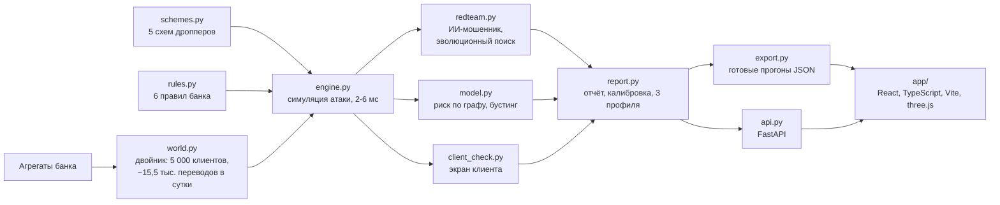

| Папка | Что внутри |
|---|---|
| `sim/fraudtwin/` | Симулятор на стандартной библиотеке Python 3.10+: мир, схемы, правила, движок, ИИ-мошенник, модель, отчёт, экспорт, API |
| `sim/tests/` | 67 автотестов: симуляция, отчёт, экран клиента, лента, API поиска, детерминизм, переводы RU/EN |
| `model/` | Обучение модели (`train.py`) и результат проверки (`benchmark.json`). Веса в `sim/fraudtwin/model_gbdt.json` |
| `app/` | Интерфейс: шаги (`App.tsx`), 3D-сцена атаки (`Scene3D.tsx`), лента (`Feed.tsx`), экран клиента, отчёт, калибровка, «Как устроено» |

## Запуск локально

Нужен Node.js 20.19+. Интерфейс работает без сервера на готовых прогонах из `app/public/scenarios`.

```bash
cd app
npm install
npm run dev            # http://localhost:4410
```

| Адрес | Что открывает |
|---|---|
| `#twin` | двойник сразу, без входа |
| `#client` | экран клиента на весь телефон (его же открывает QR-код) |
| `#report`, `#calib`, `#how` | отчёт, калибровку под банк, «Как устроено» |
| `?lang=en` | английский интерфейс |

Клавиши демо: стрелка вправо запускает главное действие шага, End проматывает в конец, на шаге «Защита» 1 включает модель, K открывает шаг «Клиент», Esc возвращает назад.

<details>
<summary><b>С сервером: свои пороги, калибровка и живой пересчёт</b></summary>

```bash
cd sim
python3 -m venv .venv
.venv/bin/pip install fastapi "uvicorn[standard]" numpy scikit-learn
cd ../app && npm install && VITE_API_URL=http://localhost:8410 npm run build && cd ../sim
.venv/bin/uvicorn fraudtwin.api:app --port 8410        # http://localhost:8410, API и интерфейс
```

API: `GET|POST /world`, `GET /attack/{key}`, `POST /attack`, `POST /redteam` (поиск обхода против присланных порогов), `GET|POST /report`, `POST /whatif`, `GET|POST /client-check`, `GET /model`, `GET /health`. Ответы в том же формате, что JSON в `app/public/scenarios`. Если API не отвечает, интерфейс переходит на готовые прогоны.

Статическая сборка без сервера: `cd app && npm run build:static`, файлы в `app/dist-static`.
</details>

<details>
<summary><b>Тесты и пересборка данных</b></summary>

```bash
cd sim
python3 -m unittest discover -s tests            # 67 тестов; без numpy и scikit-learn часть пропускается
.venv/bin/python -m fraudtwin.export             # пересобрать готовые прогоны, несколько минут
.venv/bin/python ../model/train.py --worlds 80   # переобучить модель, около 1,5 мин на CPU
```
</details>

## Ограничения

- Всё посчитано на синтетике. Качество модели на данных банка мы не измеряли.
- Результаты поиска - нижние оценки. Против модели поиск не сходится (по 10 запускам разброс от 0 до 98% на одной схеме), настоящий обход, скорее всего, больше показанного.
- Наша модель не защищает от нового поиска: обход в 5 из 5 схем. Мы продаём проверку, модель - одна из мер, которые она оценивает.
- Параметры двойника - гипотезы до разговоров с антифрод-специалистами банков.
- Слабое место модели - дробление платежа под лимит. Первая жертва на новую карту проходит без предупреждения в 80,2% случаев.
- Задержка первого перевода в двойнике - сценарий моделирования, в РК для переводов физлиц такой нормы нет.
- Без сервера доступны три готовых профиля банка. Свою калибровку и поиск против своих порогов считает API.

<details>
<summary><b>Как устроен двойник</b></summary>

- Честный банк: сегменты клиентов, круг общения, общие телефоны в семьях. Есть честные сценарии, похожие на транзит денег: сбор на подарок, передача по семье, аренда после зарплаты. Они нужны, чтобы модель не принимала обычную жизнь за дропов.
- Пять схем дропперов из публичных кейсов РК (у каждой поле `source`): студенческие карты с выводом в крипту, звонок «службы безопасности» с веером дропов, дробление под лимит, фейковый продавец, карусель через онлайн-казино. У дроп-карт есть маскировочная обычная жизнь.
- Шесть правил банка: лимит перевода, суточный лимит, частота переводов, новый получатель и крупная сумма, молодой счёт с крупным входящим, один телефон у нескольких клиентов.
- ИИ-мошенник меняет девять параметров схемы: размер частей платежа, число слоёв и ветвление, паузы, возраст дроп-карт, число карт на телефон, способ вывода. Поиск эволюционный: отбор по выведенной сумме за вычетом цены схемы, скрещивание и мутации, затем доводка мелкими шагами. Стартовая популяция засевается лучшими прошлыми атаками (`sim/fraudtwin/attack_seeds.json`), они перепроверяются на текущих правилах.
- Готовые прогоны: 8 независимых запусков на схему, против модели 12, побеждает лучший по деньгам. Живой поиск на сайте: 2 запуска (с моделью 1), около 4 с на публичной ссылке. Зёрна фиксированы: один и тот же запрос даёт один и тот же ответ.
</details>

<details>
<summary><b>Метод проверки и результаты по профилям</b></summary>

- Leave-one-scheme-out: модель учится на четырёх схемах и проверяется на пятой, которой не видела. Датасет: 400 смоделированных миров, около 1 млн переводов. На невиданных схемах правила банка в среднем пропускают 44,5% денег, модель 2,2%.
- Главная метрика - деньги: какая доля попытки вывода уходит из банка. Рядом всегда цена: сколько честных переводов на 10 тыс. задержано.
- Против готовой защиты ИИ-мошенник ищет заново. Мера считается рабочей, если новый поиск тоже не находит крупной дыры. Наша модель этот тест не проходит.
- Схема из библиотеки (студенческие карты): уходит 4,2 из 11,5 млн ₸ (37,1%). ИИ находит вариант с выводом не меньше 94,1% (платёж жертвы частями по 102 тыс. ₸, один слой дропов). С моделью эта атака выводит 0 ₸, задержек у честных 24,3 на 10 тыс. вместо 22,7.
- Свой лимит не спасает: при лимите 300 тыс. ₸ уходит не меньше 93,1%, при 700 тыс. не меньше 94,1%.
- Экран клиента: ложное предупреждение получают около 6 честных переводов из 10 тыс. Следующие жертвы на той же карте прикрыты в 100% случаев (96 из 96).

| Профиль | Через дыры, не меньше | ИИ против модели, не меньше | Обход модели |
|---|---|---|---|
| Демо-банк | 51,8 из 54,3 млн ₸ (95,4%) | 33,7 из 44,1 млн ₸ (76,4%) | 5 из 5 схем |
| Цифровой банк | 48,8 из 52,6 млн ₸ (92,8%) | 38,7 из 48,3 млн ₸ (80,2%) | 5 из 5 схем |
| Региональный банк | 51,3 из 51,7 млн ₸ (99,1%) | 39,5 из 48,9 млн ₸ (80,8%) | 5 из 5 схем |
</details>

<details>
<summary><b>Правовая база и источники цифр</b></summary>

- Закон РК «О платежах и платёжных системах» № 11-VI, ст. 25-1 (adilet.zan.kz/rus/docs/Z1600000011, сверено 23.11.2026): п. 3-1 разрешает банку приостановить перевод на срок не более пяти рабочих дней с сообщением клиенту причин; п. 7 делает банк ответственным перед клиентом, если он перечислил деньги получателю из базы антифрод-центра.
- АРРФР (28.07.2026): обязательные антифрод-подразделения, задержка подозрительного перевода до 5 рабочих дней, сессионный антифрод с апреля 2026, обмен рисками P2P.
- Больше 112 млрд ₸ через дропперов: АФМ РК, gov.kz, 11.07.2026.
- 12,2 млрд ₸ ущерба от интернет-мошенничества за 2025 год: Генпрокуратура, bes.media, 08.04.2026.
- 23 банка второго уровня РК: АРРФР, на 01.07.2026.
- Ориентир цены вендоров: Feedzai на AWS Marketplace, около 349 тыс. USD за 3 года для малой конфигурации.
</details>

<details>
<summary><b>Лицензии</b></summary>

Код: MIT, файл `LICENSE`. 3D-модели в `app/public/models/`, подробно в `app/CREDITS.md`:
- CC-BY 3.0, строка авторства показана в подвале отчёта: ATM (J-Toastie, poly.pizza), server rack (Jeremy Eyring, poly.pizza).
- CC0 1.0: Security Camera 01 (Alexander Otterbeck, риг Yann Kervran, Poly Haven), Classic Laptop (Arrangemonk, Poly Haven), Coin, Coin Piles, Man in Suit (Quaternius, poly.pizza).
- Библиотеки: drei, @react-three/fiber, @react-three/postprocessing, postprocessing (MIT). Шрифт Inter (OFL), локально. Код под AGPL не использован.
</details>

## Команда

| Shadil Nurmukhammed | Amangeldiev Kaisar | Ordalin Nurassyl | Ratlyauly Islam |
|:---:|:---:|:---:|:---:|
